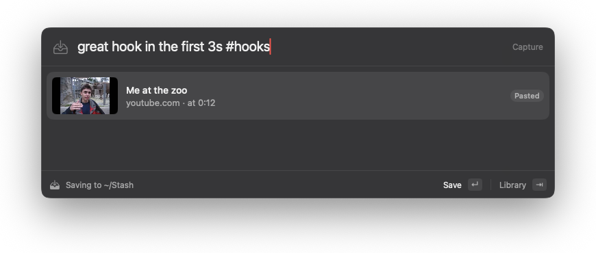
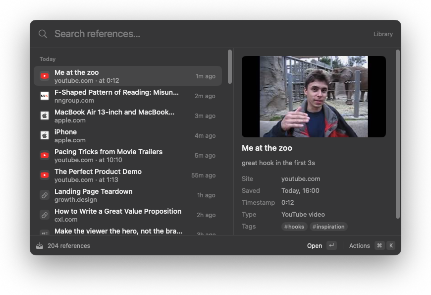
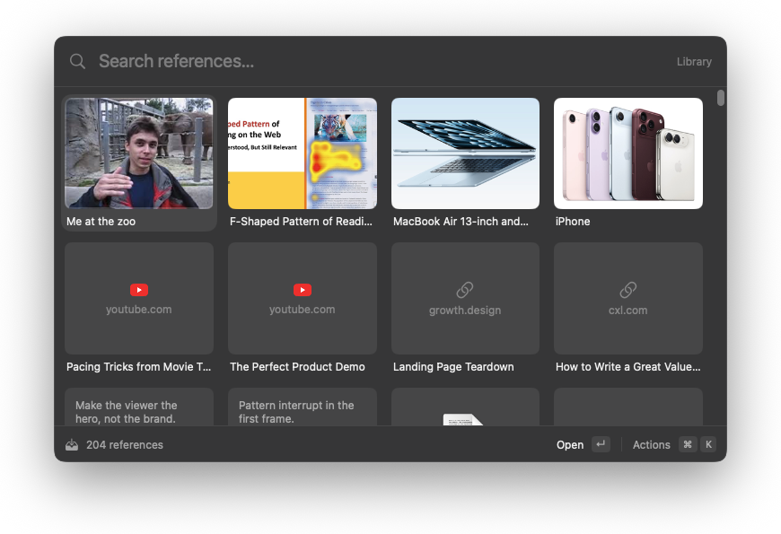

# Stash

**Save anything in two keystrokes. Find it again in one.**

Stash is a free, open source, fully local macOS menu bar app for saving references: the
YouTube video you're watching (at the exact second), the article you're reading, a quote, a
screenshot, an ad creative, a PDF. Press a shortcut, a Raycast-style panel shows what you're
looking at, press Enter, done. The same panel lets you search and browse everything later.

Every reference is a plain Markdown file in a normal folder. No account, no server, no analytics.

| Capture | Library | Grid |
|---|---|---|
|  |  |  |

<sub>Screenshots use the built-in sample data.</sub>

## What it does

- **Capture** (`⌥⇧S`): saves the current browser tab (Safari, Chrome, Arc, Brave, Edge), with
  the YouTube timestamp you're at. Not in a browser? It offers what you copied in the last
  minute, or you paste, type or drop anything: links, text, images, files.
- **Notes and tags**: type `great hook in the first 3s #hooks #thumbnails` before pressing Enter.
  `#` suggests tags you already use.
- **Library** (`⌥⇧L`, or `⇥` from Capture): instant search across titles, notes, tags, sites and
  the text inside saved PDFs and text files. Filter with `#tag` or `type:image`, `type:link`,
  `type:text`, `type:file`. List with a preview, or a grid (`⌘G`) for browsing.
- **Actions** (`⌘K`): open, open at the timestamp, copy, edit note and tags, reveal in Finder, delete.
- **Titles and thumbnails** are fetched for saved links and kept with your library.

### Keyboard

| Key | Capture | Library |
|---|---|---|
| `↵` | Save | Open |
| `⌘↵` | Save and keep the panel open | Open at timestamp |
| `⇥` | Switch to Library | Switch to Capture |
| `↑ ↓ ← →` | Pick a tag suggestion | Move the selection (← → in the grid) |
| `⌘K` | | Actions |
| `⌘G` | | Grid / list |
| `⌘E` | | Edit note and tags |
| `⌘C` | | Copy link, text, image or file |
| `⌘⇧F` | | Reveal in Finder |
| `⌘⌫` | Clear what's captured | Delete (asks first) |
| `⌘V` | Replace the capture with the clipboard | Paste into the search |
| `⌘,` | Settings | Settings |
| `Esc` | Close | Clear the search, then close |

Both shortcuts can be changed in Settings.

## Install

1. Download `Stash-x.y.z.zip` from [Releases](https://github.com/osamuelrc/stash/releases), unzip it
   and move **Stash** to Applications.
2. Open it. Stash isn't notarized by Apple yet, so macOS stops it the first time:
   open **System Settings › Privacy & Security**, scroll down and click **Open Anyway** (on macOS 14
   you can also right-click the app › **Open**). Alternatively:
   `xattr -dr com.apple.quarantine /Applications/Stash.app`.
3. Stash lives in the menu bar (the tray icon); it has no Dock icon. Press `⌥⇧S` to capture.

Requires macOS 14 Sonoma or later.

## Permissions

Stash asks for as little as possible, and only when it's needed:

- **Automation (control your browser)**: the first time you capture from a browser, macOS asks
  whether Stash may control it. Stash only reads the current tab's address and title (and, for
  YouTube, the playing position). Change it any time in **System Settings › Privacy & Security ›
  Automation**.
- **YouTube timestamps** need the browser to allow JavaScript from Apple Events. It's off by
  default; Stash shows a one-time tip if it can't read the position:
  - Chrome, Brave, Edge, Arc: **View › Developer › Allow JavaScript from Apple Events**.
  - Safari: **Settings › Advanced › Show features for web developers**, then **Settings ›
    Developer › Allow JavaScript from Apple Events**.

  Without it, Stash keeps any `t=` already in the link.
- **Launch at login** (optional, in Settings) uses the standard Login Items.

Stash does not need Accessibility, Screen Recording, Full Disk Access or any other permission.

## Privacy

- **Your data never leaves your Mac.** No account, no server, no analytics, no telemetry, no
  crash reporting.
- **The only network requests** fetch the title, preview image and icon of links you save, from
  the site itself (for YouTube: its public oEmbed endpoint and thumbnail images). No cookies are
  sent or kept. Turn it off in **Settings › Capture › Fetch titles & thumbnails** and Stash makes
  no network requests at all.
- **The clipboard** is only read when you open Capture, and only if you copied something
  recently (1 minute by default, configurable, or off). Anything a password manager marks as
  secret is never captured.

## Where your data lives

```
~/Stash/                      ← the library (change it in Settings, e.g. to iCloud Drive)
  items/
    2026-10-14-great-hook-in-the-first-3s.md
  assets/
    01JA8K3Q7Z2M4X5C6V7B8N9P0Q.jpg     ← thumbnails, images and files, named by reference ID
    icons/youtube.com.png              ← one icon per site

~/Library/Application Support/Stash/
  index.sqlite                ← search index; a cache, rebuilt from the files at any time
```

Each reference is a Markdown file with a small header:

```markdown
---
id: 01JA8K3Q7Z2M4X5C6V7B8N9P0Q
type: link
url: https://www.youtube.com/watch?v=dQw4w9WgXcQ&t=272s
title: How I Write Hooks That Stop the Scroll
site: youtube.com
timestamp: 272
tags: [hooks, thumbnails]
thumbnail: assets/01JA8K3Q7Z2M4X5C6V7B8N9P0Q.jpg
created: 2026-10-14T10:20:00-03:00
---
great hook in the first 3s
```

Text references keep the saved text as the body and the note in a `note:` field. You can edit
the files in any editor (they open fine in Obsidian); Stash picks up changes, new files and
deletions right away, and keeps front matter fields it doesn't know about.

**Several Macs:** move the library into iCloud Drive, Dropbox or a Syncthing folder (Settings ›
Library › Choose…). On the other Mac, choose the same folder: Stash notices it already holds a
library and uses it. Deleting a reference moves its files to the Trash.

## Build from source

Requires macOS 14+ and a recent **Xcode** (tested with Xcode 27; the Command Line Tools alone
aren't enough, one dependency needs Xcode's macros). Then, from the repository:

```sh
scripts/run.sh
```

That builds `build/Stash.app`, quits any running copy and opens the new one. Other commands:

```sh
scripts/build-app.sh          # build build/Stash.app only (release, ad-hoc signed)
swift test                    # run the tests
swift scripts/make-icon.swift # regenerate the placeholder app icon
```

Development aids:

- Hold `⌥` while opening the menu bar menu for debug commands (sample references).
- `open build/Stash.app --args -libraryPath /tmp/stash-test` uses another library for one run.
- `open build/Stash.app --args -StashShowPanel library` opens the panel at launch.
- Debug builds (`.build/debug/Stash`) can be driven by scripts: see
  [`Sources/Stash/App/DebugHooks.swift`](Sources/Stash/App/DebugHooks.swift).

Pushing a tag like `v0.1.0` makes GitHub Actions build, test and publish
`Stash-0.1.0.zip` as a release (see [`.github/workflows/build.yml`](.github/workflows/build.yml)).

See [CONTRIBUTING.md](CONTRIBUTING.md) for how the code is organized.

## License

MIT. See [LICENSE](LICENSE).
