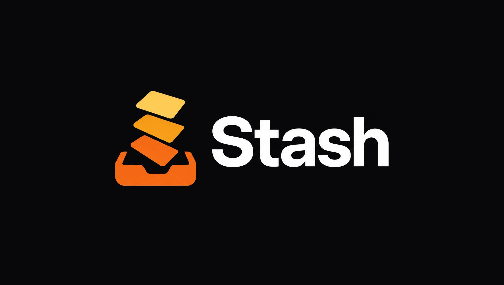
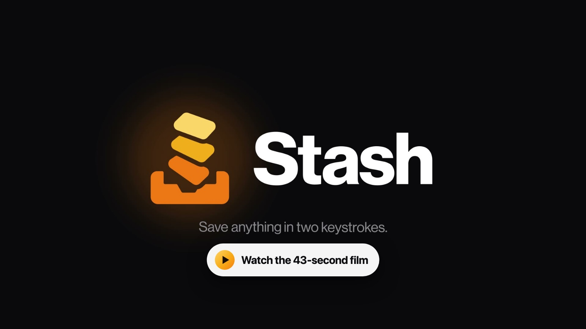

<p align="center">
  
</p>

<p align="center">
  <strong>Save anything in two keystrokes. Find it again in one.</strong>
</p>

<p align="center">
  <b>English</b> · <a href="README.pt-BR.md">Português</a> · <a href="README.es.md">Español</a> · <a href="README.fr.md">Français</a>
</p>

<p align="center">
  <a href="https://s4mu3ldemolidor.github.io/stash/">Website</a> ·
  <a href="https://github.com/S4MU3LDemolidor/stash/releases/latest">Download</a> ·
  <a href="#install">Install</a> ·
  <a href="#privacy">Privacy</a> ·
  <a href="#build-from-source">Build from source</a>
</p>

<p align="center">
  <a href="https://github.com/S4MU3LDemolidor/stash/actions/workflows/build.yml"></a>
  
  
</p>

---

Stash is a free, open source, fully local macOS menu bar app for saving references: the
YouTube video you're watching (at the exact second), the article you're reading, a quote, a
screenshot, an ad creative, a PDF. Press a shortcut, a Raycast-style panel shows what you're
looking at, press Enter, done. The same panel lets you search and browse everything later.

Every reference is a plain Markdown file in a normal folder. No account, no server, no analytics.

<p align="center">
  <a href="https://s4mu3ldemolidor.github.io/stash/#film"></a>
</p>

| Capture | Library | Grid |
|---|---|---|
|  |  |  |

<sub>Screenshots show sample references; all the artwork in them is original.</sub>

## Why

Saving references is slow and scattered: bookmarks you never open, screenshots piling up on
the desktop, ideas sent to yourself in chat, "watch later" lists that become graveyards. Stash
makes saving take two keystrokes and finding take one, and keeps everything as files you own.

## Features

- **Capture** (`⌥⇧S`): saves the current browser tab (Safari, Chrome, Arc, Brave, Edge), with
  the YouTube timestamp you're at. Not in a browser? It offers what you copied in the last
  minute, or you paste, type or drop anything: links, text, images, files. A copied image
  always wins over the tab.
- **Notes and tags**: type `great hook in the first 3s #hooks #thumbnails` before pressing Enter.
  `#` suggests the tags you already use.
- **Already saved?** Capture tells you ("Already saved 3 weeks ago"), and `↵` adds your new note
  and tags to that reference instead of making a second one. `⌥↵` saves a separate copy.
- **Library** (`⌥⇧L`, or `⇥` from Capture): instant search on every keystroke across titles,
  notes, tags, sites and the text inside saved PDFs, text files and images. Filter with `#tag` or
  `type:image`, `type:link`, `type:text`, `type:file`. Results grouped by Today, Yesterday,
  This Week and Earlier.
- **Text in images**: screenshots and ad creatives are searchable by what they say. Stash reads
  the text on your Mac with Apple's Vision and shows it in the detail pane (`⌘K` copies it).
- **List and grid**: a list with a preview pane, or a grid (`⌘G`) for browsing visually.
- **Actions** (`⌘K`): open, open at the timestamp, copy, edit note and tags, reveal in Finder,
  delete (to the Trash).
- **Titles, thumbnails and site icons** are fetched for saved links and kept with your library.
- **Plain files**: Markdown with YAML front matter, readable in any editor or Obsidian; edits
  made elsewhere show up instantly.
- **Your folder, anywhere**: keep the library in iCloud Drive, Dropbox or Syncthing to use it on
  several Macs.
- **Shelf**: while dragging anything (files, folders, images, text, links), shake the mouse and
  a shelf appears under the cursor. Drop it there, go wherever you need, and drag it back out
  later. You can also drop things on the menu bar icon.
- **In your language**: English, Português (Brasil), Español and Français. Stash follows your
  Mac's language; pick another one just for Stash in **System Settings › General › Language &
  Region › Applications**.
- **Native**: light and dark mode, VoiceOver, Reduce Motion and Reduce Transparency.

## Install

With [Homebrew](https://brew.sh):

```sh
brew install --cask s4mu3ldemolidor/tap/stash-references
```

Or by hand:

1. Download **`Stash-x.y.z.dmg`** from the [latest release](https://github.com/S4MU3LDemolidor/stash/releases/latest).
2. Open it and drag **Stash** onto **Applications**.
3. Open Stash from Applications. It isn't notarized by Apple yet, so the first time macOS
   stops it: open **System Settings › Privacy & Security**, scroll down and click
   **Open Anyway** (on macOS 14 you can also right-click the app › **Open**). Or, in Terminal:
   ```sh
   xattr -dr com.apple.quarantine /Applications/Stash.app
   ```
4. Stash lives in the **menu bar** (the tray icon); it has no Dock icon. A hint shows the
   shortcut the first time. Press `⌥⇧S` to capture.

Stash isn't notarized yet, so with Homebrew too, the first launch needs **Open Anyway** (step 3).
Homebrew updates it with `brew upgrade`.

Requires macOS 14 Sonoma or later. To start Stash automatically, turn on **Settings › Launch at login**.

## How to use it

### Capture

1. Press `⌥⇧S` anywhere.
2. The panel shows what will be saved: the current browser tab, something you just copied, or
   an empty card to paste, type or drop into.
3. Optionally type a note with `#tags`.
4. Press `↵`. The panel closes and **Saved to Stash** confirms it. (`⌘↵` saves and keeps the
   panel open for the next one.)

If it's already in your library (the same page, even shared with tracking parameters; the same
moment of a video; the same text, image or file), the card says **Already saved** and `↵` adds
your note and tags to that reference. `⌥↵` saves a separate copy anyway.

### Library

Press `⌥⇧L`, type to search, `↑ ↓` to move, `↵` to open. `#tag` and `type:` become filter pills
(`⌫` in an empty field removes the last one). No results? `↵` saves your search as a note.

### Shelf

1. Start dragging something: a file in Finder, an image or a link in your browser, some text.
2. Shake the mouse left and right. A shelf appears under the cursor; let go onto it.
3. Later, drag the stack out to take everything, or click it and drag single items.

Dragging out works like finishing the original drag: Finder moves a file within the same disk
and copies it to another one. Hold `⌥` to copy and keep it on the shelf too. The shelf stays on
screen while it holds anything (also after a restart), and `×` clears it. Files on the shelf
are references to the originals, never copies, so big videos cost nothing. Dropping things on
the menu bar icon also puts them on the shelf. Turn shaking off in **Settings › Shelf**.

### Keyboard

| Key | Capture | Library |
|---|---|---|
| `↵` | Save | Open |
| `⌘↵` | Save and keep the panel open | Open at timestamp |
| `⌥↵` | Save a copy of something already saved | |
| `⇥` | Switch to Library | Switch to Capture |
| `↑ ↓ ← →` | Pick a tag suggestion | Move the selection (← → in the grid) |
| `⌘K` | | Actions |
| `⌘G` | | Grid / list |
| `⌘E` | | Edit note and tags |
| `⌘C` | | Copy link, text, image or file |
| `⌘⇧F` | | Reveal in Finder |
| `⌘⌫` | Clear what's captured | Delete (asks first) |
| `⌘V` | Replace the capture with the clipboard | Paste into the search |
| `⌘,` | Settings | Settings |
| `Esc` | Close | Clear the search, then close |

Both global shortcuts can be changed in **Settings › Shortcuts**.

### Settings

Shortcuts · library folder (choose, reveal, rebuild index) · fetch titles & thumbnails ·
how recently copied things are offered (30 s, 1 min, 5 min, off) · shake to open the shelf ·
launch at login · show the menu bar icon. If you hide the icon, open Stash again from Finder or Spotlight to get back to
Settings.

## Permissions

Stash asks for as little as possible, and only when it's needed:

- **Automation (control your browser)**: the first time you capture from a browser, macOS asks
  whether Stash may control it. Stash only reads the current tab's address and title (and, for
  YouTube, the playing position). Change it any time in **System Settings › Privacy & Security ›
  Automation**.
- **YouTube timestamps** need the browser to allow JavaScript from Apple Events. It's off by
  default; Stash shows a one-time tip if it can't read the position:
  - Chrome, Brave, Edge, Arc: **View › Developer › Allow JavaScript from Apple Events**.
  - Safari: **Settings › Advanced › Show features for web developers**, then **Settings ›
    Developer › Allow JavaScript from Apple Events**.

  Without it, Stash keeps any `t=` already in the link.
- **Launch at login** (optional) uses the standard Login Items.

Stash does not need Accessibility, Screen Recording, Full Disk Access or any other permission.

## Privacy

- **Your data never leaves your Mac.** No account, no server, no analytics, no telemetry, no
  crash reporting.
- **The only network requests** fetch the title, preview image and icon of links you save, from
  the site itself (for YouTube: its public oEmbed endpoint and thumbnail images). No cookies are
  sent or kept. Turn it off in **Settings › Capture › Fetch titles & thumbnails** and Stash makes
  no network requests at all.
- **Text in images** is read on your Mac by Apple's Vision framework and kept only in the search
  index; your files don't change.
- **The shelf** stays on your Mac too: files are kept as references to the originals, and
  dragged images, text and links as small private copies in
  `~/Library/Application Support/Stash/Shelf/`. It never touches your library or the network,
  and Stash never moves or deletes an original itself.
- **The clipboard** is only read when you open Capture, and only if you copied something
  recently. Anything a password manager marks as secret is never captured, and things you copy
  from Stash itself aren't offered back.

## Where your data lives

```
~/Stash/                      ← the library (change it in Settings, e.g. to iCloud Drive)
  items/
    2026-10-14-great-hook-in-the-first-3s.md
  assets/
    01JA8K3Q7Z2M4X5C6V7B8N9P0Q.jpg     ← thumbnails, images and files, named by reference ID
    icons/youtube.com.png              ← one icon per site

~/Library/Application Support/Stash/
  index.sqlite                ← search index (and text read from images); a cache, rebuilt from the files at any time
  Shelf/                      ← what's on the shelf (shelf.json + private copies in Items/)
```

Each reference is a Markdown file with a small header:

```markdown
---
id: 01JA8K3Q7Z2M4X5C6V7B8N9P0Q
type: link
url: https://www.youtube.com/watch?v=dQw4w9WgXcQ&t=272s
title: How I Write Hooks That Stop the Scroll
site: youtube.com
timestamp: 272
tags: [hooks, thumbnails]
thumbnail: assets/01JA8K3Q7Z2M4X5C6V7B8N9P0Q.jpg
created: 2026-10-14T10:20:00-03:00
---
great hook in the first 3s
```

Text references keep the saved text as the body and the note in a `note:` field. Stash keeps
front matter fields it doesn't know about, so you can add your own (in Obsidian, for example).

**Several Macs:** in **Settings › Library › Choose…**, move the library into iCloud Drive,
Dropbox or a Syncthing folder. On the other Mac, choose the same folder: Stash sees it already
holds a library and uses it. Deleting a reference moves its files to the Trash.

**If Stash disappears tomorrow**, your library is still a folder of Markdown files and images.

## Build from source

Requires macOS 14+ and a recent **Xcode** (tested with Xcode 27; the Command Line Tools alone
aren't enough, one dependency needs Xcode's macros).

```sh
git clone https://github.com/S4MU3LDemolidor/stash.git
cd stash
scripts/run.sh
```

`scripts/run.sh` builds `build/Stash.app`, quits any running copy and opens the new one.

| Command | What it does |
|---|---|
| `scripts/run.sh` | Build and launch the app |
| `scripts/build-app.sh` | Build `build/Stash.app` (release, ad-hoc signed) |
| `scripts/make-dmg.sh` | Build the app and `build/Stash-<version>.dmg` |
| `swift test` | Run the tests |
| `scripts/check-strings.sh` | Check every language's strings against the code |
| `swift scripts/make-icon.swift` | Regenerate `Support/AppIcon.icns` from the icon artwork |

Set `STASH_VERSION` (and optionally `STASH_BUILD`) for versioned builds, e.g.
`STASH_VERSION=0.3.0 scripts/make-dmg.sh`.

**Translations:** `Support/Localization/<language>.lproj/Localizable.strings`, one table per
language, where each key is the English text. After changing UI text, run
`scripts/check-strings.sh sync-en` to update the English table, then translate the new keys
(`scripts/check-strings.sh missing pt-BR` lists them). CI fails when a language is missing a string.

**Website:** `site/` is published to GitHub Pages on every push to `main` that changes it
(see [`.github/workflows/pages.yml`](.github/workflows/pages.yml)). `site/index.html` is the
English page; `python3 site/i18n/build.py` writes the other languages from `site/i18n/*.json`.
Preview it with `python3 site/i18n/build.py && python3 -m http.server 8080 --directory site`.

**Homebrew:** the cask lives in [S4MU3LDemolidor/homebrew-tap](https://github.com/S4MU3LDemolidor/homebrew-tap)
(its source is in [`packaging/homebrew-tap`](packaging/homebrew-tap)) and updates itself daily from the latest release.

**Releases:** pushing a tag like `v0.1.0` makes GitHub Actions build, test and publish
`Stash-0.1.0.dmg` and `Stash-0.1.0.zip` (see [`.github/workflows/build.yml`](.github/workflows/build.yml)).

**Development aids:**

- Hold `⌥` while opening the menu bar menu for debug commands (generate or remove 200 sample
  references, tagged `#sample`).
- `open build/Stash.app --args -libraryPath /tmp/stash-test` uses another library for one run.
- `open build/Stash.app --args -StashShowPanel library` opens the panel at launch.
- `open build/Stash.app --args -AppleLanguages "(pt-BR)"` runs Stash in another language.
- Debug builds (`.build/debug/Stash`) can be driven by scripts: see
  [`Sources/Stash/App/DebugHooks.swift`](Sources/Stash/App/DebugHooks.swift).

### Project layout

```
Sources/Stash/
  App/          entry point, menu bar, debug commands
  Panel/        the floating panel, its keyboard map
  Capture/      browser tab, clipboard, paste and drop, saving, duplicates
  Library/      search, list, detail pane, grid, ⌘K actions
  Components/   search bar, action bar, keycaps, pills, HUD
  Model/        references, tags, slugs, IDs
  Storage/      Markdown files, folder sync, search index (GRDB + FTS5), text in images
  Enrichment/   YouTube, titles and thumbnails
  Settings/     preferences and the Settings window
  Shelf/        the shake-to-open shelf
  Design/       design tokens and the Stash mark
Support/        Info.plist, entitlements, app icon, translations (Localization/)
docs/           brand assets and screenshots
site/           the website (plain HTML, CSS and JS; published to GitHub Pages)
packaging/      the Homebrew tap's source
```

Built with Swift, SwiftUI and AppKit, plus two libraries:
[KeyboardShortcuts](https://github.com/sindresorhus/KeyboardShortcuts) (global shortcuts) and
[GRDB.swift](https://github.com/groue/GRDB.swift) (SQLite full-text search).

See [CONTRIBUTING.md](CONTRIBUTING.md) for principles and conventions.

## Brand

The logo and app icon live in [`docs/brand`](docs/brand). The menu bar icon is the same mark,
drawn as vectors in [`StashMark.swift`](Sources/Stash/Design/StashMark.swift) so it stays sharp
and follows the menu bar's light and dark appearance.

## License

MIT. See [LICENSE](LICENSE).
